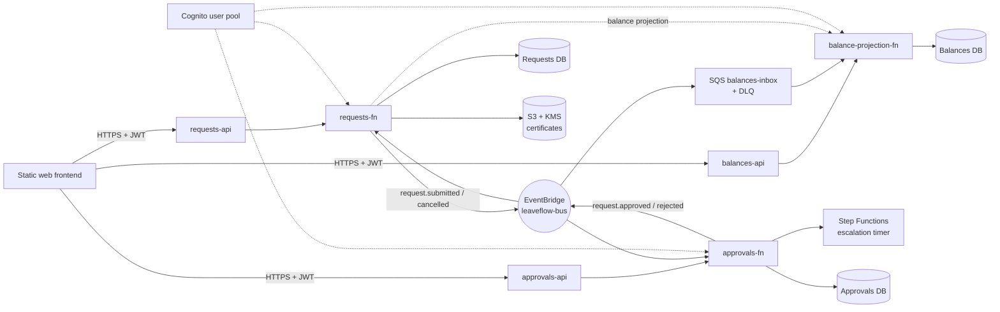

# LeaveFlow

**Leave management for small teams, built as three event-driven cloud services.**

Employees request leave with instant policy checks. Managers approve with team-coverage protection. HR manages balances on an append-only ledger.


---

## Table of contents

- [Features](#features)
- [Architecture](#architecture)
- [Tech stack](#tech-stack)
- [Repository structure](#repository-structure)
- [Getting started](#getting-started)
- [Configuration](#configuration)
- [Testing](#testing)
- [Security](#security)
- [Project status](#project-status)
- [Team](#team)

---

## Features

### Employees
- Submit leave requests with a live working-day preview that excludes weekends and Egyptian public holidays.
- Get instant policy checks: notice period, blackout dates, overlapping requests and available balance.
- Track each request on a status timeline; withdraw pending requests or cancel approved ones.
- Upload medical certificates for sick leave to private, encrypted storage.
- View their own balance and the full ledger history.

### Managers
- Work through an approval queue with a team-coverage indicator. Approval is blocked when more than 30% of the team would be away.
- See a team calendar and their decision history.
- Requests not decided in time escalate automatically to HR.

### HR administrators
- Take the second approval step for long or unpaid leave.
- See all employee balances, with bounded and audited adjustments.
- Run monthly accruals, the casual-leave grant and the year-end carry-over and expiry.
- Export balances to CSV.

---

## Architecture

Each service owns its data and runs on AWS-style serverless components. Services communicate through events on a shared bus, never through each other's databases.



| Service | Responsibility | Lambda | API |
|---|---|---|---|
| **Leave Request & Policy Engine** | Sign-in, MFA, request lifecycle, policy rules, certificates | `requests-fn` | `requests-api` |
| **Approval Workflow** | Approval routing, coverage rule, escalation, notifications, team calendar | `approvals-fn` | `approvals-api` |
| **Balance & Accrual** | Ledger, holds, deductions, refunds, accruals, HR adjustments, audit log | `balance-projection-fn` | `balances-api` |

Event processing is **at-least-once**. Every consumer is idempotent, backed by database constraints on event and request identifiers, so a redelivered event never creates a second hold, deduction, refund or workflow.

---

## Tech stack

| Layer | Technology |
|---|---|
| Frontend | HTML, CSS and vanilla JavaScript (no framework, no runtime dependencies) |
| Backend | Node.js 20, Express 5, `serverless-http`, `jose` |
| Identity | Amazon Cognito (user groups, TOTP MFA) |
| Compute and API | AWS Lambda, API Gateway HTTP APIs |
| Messaging | EventBridge, SQS with dead-letter queues, SNS, Step Functions |
| Data | PostgreSQL on Neon (one database per service) |
| Storage and secrets | S3 with KMS encryption, Secrets Manager, SSM Parameter Store |
| Observability | CloudWatch Logs, metric filters and alarms |
| External API | [Nager.Date](https://date.nager.at) public holidays |
| Local cloud | Floci, an AWS-compatible emulator |

---

## Repository structure

```text
LeaveFlow/
├── index.html, login.html     Landing and sign-in pages
├── pages/                     Application pages
│   ├── requests/              New request, my requests, request detail
│   ├── approvals/             Queue, decision history, team calendar
│   └── balance/               My balance, HR balances, accrual log, HR views
├── css/                       Design tokens and components
├── js/
│   ├── config.js              API endpoints and runtime switches
│   ├── api.js                 API client (one function per endpoint)
│   ├── ui.js                  App shell, navigation, modals, toasts, idle logout
│   └── pages/                 Logic for each page
├── services/
│   ├── leave-request-service/
│   ├── approval-service/
│   └── balance-service/
│       ├── src/               Express app, Lambda handler, routes, domain logic
│       ├── db/                Schema, migrations, least-privilege grants
│       ├── deploy/            Deployment script and IAM policies
│       └── tests/             Unit and isolated integration tests
└── tools/                     Page generator for the HTML wrappers
```

---

## Getting started

### Prerequisites

- Node.js 20 or later
- Docker, running Floci on `http://localhost:4566`
- AWS CLI v2, with a dedicated profile for Floci:
  ```bash
  aws configure --profile leaveflow-floci   # any non-empty keys; region us-east-1
  ```
- PowerShell 7 to run the deployment scripts
- A PostgreSQL database for each service (Neon was used)

### 1. Install dependencies

```bash
cd services/leave-request-service && npm ci && cd ../..
cd services/approval-service      && npm ci && cd ../..
cd services/balance-service       && npm ci && cd ../..
```

### 2. Configure each service

Copy `services/<service>/.env.example` to `.env` and fill in the database URL and settings. Never commit `.env` files; they are gitignored.

### 3. Deploy to Floci

Deploy in this order, because each step uses resources created by the one before:

```powershell
pwsh services/leave-request-service/deploy/deploy-cognito.ps1   # Cognito pool, groups and users
pwsh services/balance-service/deploy/deploy.ps1
pwsh services/approval-service/deploy/deploy.ps1                 # also creates the shared event bus
pwsh services/leave-request-service/deploy/deploy.ps1
```

Each script writes a `*-outputs.json` file with the deployed API URL.

### 4. Run the frontend

Put the three API URLs in `js/config.js`, then serve the repository root:

```bash
python -m http.server 8080
# open http://localhost:8080
```

Sign in with a Cognito user created in step 3. Managers and HR administrators are asked to set up an authenticator app at their first sign-in.

> **Offline UI mode:** set `MOCK: true` in `js/config.js` to serve every page from `js/mock-data.js` without any backend.

---

## Configuration

### Frontend

`js/config.js` is the single place the frontend is configured:

| Setting | Purpose |
|---|---|
| `APIS.requests`, `APIS.approvals`, `APIS.balances` | Base URLs of the three APIs |
| `MOCK` | `true` serves every page from `js/mock-data.js` with no backend |
| `LIVE` | Switches individual services between live and mock data |
| `IDLE_LOGOUT_MINUTES` | Automatic sign-out after inactivity |

When the API origins change, update the Content-Security-Policy `connect-src` in the page headers to match.

### Backend

Lambda environment variables hold only **names and identifiers**, for example `SECRET_NAME`, `COGNITO_USER_POOL_ID` and `EVENT_BUS_NAME`. Database credentials are read from Secrets Manager at runtime.

---

## Testing

```bash
# Balance & Accrual: unit and route tests (in-memory database double, local JWKS)
cd services/balance-service && npm test
```

The balance suite has 99 tests. They cover:
- ledger and hold maths;
- event handling and idempotency;
- cancellation and refund rules;
- accrual runs;
- HR adjustments;
- token verification;
- MFA enforcement;
- log redaction.

`services/balance-service/tests/isolated/sqs-dlq.isolated.mjs` checks dead-letter routing against disposable SQS queues on Floci, which it deletes afterwards.

> ⚠️ The `smoke.ps1` scripts in the requests and approvals services create and approve **real** leave requests. Run them only against a disposable environment.

---

## Security

| Area | Controls |
|---|---|
| **Authentication** | Cognito ID tokens are verified in every Lambda: signature, issuer, audience, expiry and token type. Short-lived tokens (15 minutes). Sign-in lockout after repeated failures. |
| **Privileged access** | Managers and HR administrators set up TOTP MFA at sign-in. The Balance service also confirms MFA enrolment on the server before honouring the HR role, and fails closed if it cannot check. |
| **Authorization** | Role checks on every route, plus object-level ownership checks. Other users' records return `404`, so they cannot be enumerated. Nobody can approve their own request. |
| **Data integrity** | Append-only ledger and audit log. Idempotent event consumers. Atomic approval claims. At most one deduction and one refund per request, enforced by the database. |
| **Database access** | One database per service. The Balance service runs as a dedicated least-privilege role (no DDL, no `TRUNCATE`, no access to other services' databases); its grant and verification scripts are in `services/balance-service/db/`. |
| **Secrets** | Secrets Manager for credentials; nothing secret in Lambda environment variables or the frontend. |
| **Files** | Private S3 bucket with KMS encryption, a MIME allow-list, a 5 MB limit and 5-minute presigned links. |
| **Frontend** | Strict Content-Security-Policy with no inline scripts, `textContent` rendering, CSV formula-injection guard, CORS allow-list, 15-minute idle logout. |
| **Resilience** | Dead-letter queues and CloudWatch alarms on access-denied spikes, failed logins, DLQ depth and escalation failures. |

---

## Project status

LeaveFlow is a university cloud-computing project. It is deployed and demonstrated on **Floci**, a local AWS-compatible emulator, and is **not production-ready**. A public deployment needs:
- the backend hosted on real AWS (or an equivalent) behind HTTPS;
- the frontend published on a static host.

Server-side MFA enforcement and least-privilege database roles are live in the Balance service and are being extended to the other two services.

---

## Team

| Member | GitHub | Ownership |
|---|---|---|
| Sohaila | [@SohailaTaher](https://github.com/SohailaTaher) | Leave Request & Policy Engine, request pages, sign-in |
| Ammar | [@3enany](https://github.com/3enany) | Approval Workflow, approval and notification pages |
| Seif | [@seifeldeendev](https://github.com/seifeldeendev) | Balance & Accrual, frontend shell and design system, balance and HR pages |
